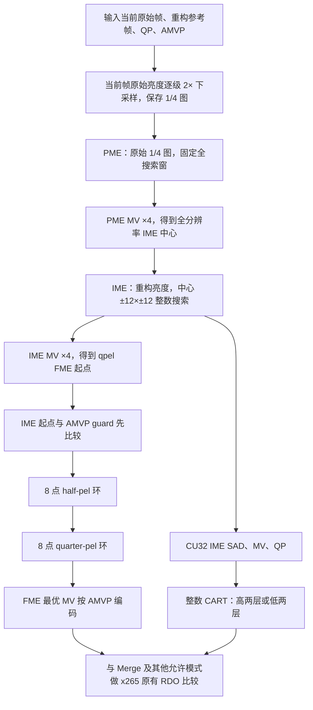

# 算法设计与硬件映射说明

## 1. 目标与约束

目标是在规则、固定上界的搜索结构中替代 x265 的通用运动搜索，便于硬件流水化和存储规划，同时尽量保持压缩率。研究配置只处理 P 帧的单参考正方形 32×32、16×16、8×8 CU/PU/TU；边界不完整的块继续递归，不允许被高两层策略提前终止。

三级之间的坐标单位必须显式转换：

- PME：1/4 分辨率原始亮度图上的整数采样单位；1 PME 单位 = 4 个全分辨率像素 = 16 个 qpel。
- IME：全分辨率重构参考图上的整数像素；1 IME 单位 = 4 个 qpel。
- FME/AMVP：HEVC 的 1/4 像素单位。

## 2. 总流程



## 3. 原始帧下采样与参考存储

每帧原始 Y 分量通过两次相位为 0 的 2×2 低通/抽取得到 1/4 宽、1/4 高的亮度图。CU32 在该图上对应 8×8；CU16 和 CU8 分别对应 4×4 和 2×2。当前帧的下采样结果随帧对象保存，成为后续 P 帧的 PME 原始参考。IME/FME 仍使用重构参考，从而保持闭环编码要求。

两级 2× 下采样的单级计算为：先分别对两列做带舍入平均，再对两个结果平均。便携 C 中的 `hw_hme_downsample4()` 给出了逐位一致的 8-bit 参考。

## 4. PME

### 4.1 搜索范围

PME 以当前块同位点为中心，在 1/4 分辨率图上搜索：

```text
dx ∈ [-32, 32]
dy ∈ [-28, 28]
```

等价全分辨率运动范围为 `[-128,128] × [-112,112]`。CU32 的理论内部候选数为 `65×57=3705`，边界位置按参考图合法范围裁剪。

### 4.2 旧代价

旧模式保留用于回归：

```text
Jlegacy = (SADds >> sadShift) × MVD_bits(MV, 0)
sadShift = 3
```

它把失真与 bits 相乘，且固定零向量 attractor；在运动明显的 BasketballDrive 上表现不稳。

### 4.3 最终自适应代价

最终模式采用加法形式：

```text
lambdaQ8 = round(x265_motion_lambda(QP) × 256)
textureClass = class(meanGradient(current_ds_block), 8, 24)
textureWeightQ8 = {256, 160, 96}[textureClass]

Jpme = SADds + round(
    MVD_bits(MV, attractor)
    × lambdaQ8
    × rateScaleQ8
    × textureWeightQ8
    / 2^24)

rateScaleQ8 = 256
```

平均梯度只需要水平/垂直相邻像素绝对差、累加和整数除法。平坦块提高码率约束，复杂纹理块降低 MVD 权重，让 SAD 更容易决定真实运动。QP 通过帧级 lambda 进入，无须从其他编码状态提取特征。

`attractor=1` 时使用当前 PU 的 AMVP；若不存在有效邻居，AMVP 自然退化到零。`attractor=2` 可计算零和 AMVP 两套 bits，选择较小者并给 AMVP 分支增加 1 bit 标志代价。最终实验使用 `attractor=1`。

## 5. IME

PME 最优向量 `(dx_ds,dy_ds)` 乘 4，得到全分辨率整数中心。IME 在重构参考亮度上做穷举：

```text
x ∈ [centerX-12, centerX+12]
y ∈ [centerY-12, centerY+12]
Jime = SADrecon + MV_cost(qpelMV, AMVP, QP)
```

内部块固定 625 个候选。`MV_cost` 复用 x265 由 `sqrt(lambda)` 加权的 MVD 代价；候选 MV 在送入该函数前由 full-pel 乘 4 对齐到 qpel。

## 6. FME、AMVP 与 Merge

FME 从 `IME×4` 的 qpel 位置开始，同时无条件加入裁剪后的 AMVP guard 候选，防止粗搜索错误淘汰已有的优秀时空预测点。两者先比较后，以较优点为中心搜索 8 个 half-pel 邻居，再以更新后的最优点搜索 8 个 quarter-pel 邻居：

```text
Jfme = subpel_SADrecon + MV_cost(qpelMV, AMVP, QP)
```

通常最多 18 个候选（IME seed、不同位置的 AMVP、8 half、8 quarter）。最终向量保持 qpel 单位，进入 x265 AMVP 编码；完整预测残差、变换、量化、熵编码估计和 Merge 比较仍由 x265 原有 RDO 完成。因此这里的 SAD 是“当前原始块与候选预测块”的带预测 SAD，不是原始块自身的无预测纹理值。

## 7. P 帧高两层/低两层选择

### 7.1 标签

采集模式先运行完整 32/16/8 RDO。如果 CU32 最终树中出现任何 8×8 叶节点，则标签为低两层（16/8）；否则为高两层（32/16）。这使训练目标直接对应原完整编码器的结构选择。

### 7.2 输入与整数特征

最终树只使用 CU32 已完成的 IME 结果和帧级 QP：

```text
qp
imeSadPerPixelQ8 = (imeSad32 + 2) >> 2
imeMvFullPelL1   = abs(mvx) + abs(mvy)
```

`imeSadPerPixelQ8` 的推导是 `SAD×256/1024`。源码还可输出 PME→IME 修正量、IME MVD、纹理和边界标志用于研究，但最终深度 4 树不依赖它们。

### 7.3 决策树

模型为深度 4 的加权 CART，叶节点固化为 0–100 的“选择低两层概率”。运行时只有整数比较、加减、绝对值和移位；默认 `probabilityCutoff=50`。完整树在 `x265_overlay/source/encoder/inter_layer_selector.h`，训练产物在 `results/inter/layer_tree/`。

模式定义：

- 0：完整 32/16/8 三层。
- 1：强制高两层 32/16。
- 2：强制低两层 16/8。
- 3：整数树自适应选择。
- 4：完整三层并输出 RDO 标签数据。

## 8. 便携 C 接口

`experiments/inter_hw_hme/portable_c/` 不依赖 x265 C++ 类。平台相关部分通过三个回调隔离：MVD bits、QP 加权 MVD cost、qpel 插值 SAD。`hw_hme_config_default()` 给出最终参数，并保留 `pme_cost_mode=0` 的旧代价对照。

推荐硬件模块边界为：下采样帧存储、PME SAD/MVD 流水线、精度转换、IME 重构参考访问、FME 插值器、AMVP/Merge 接口、层级决策树。软件参考中的确定性平局规则依次比较 cost、SAD、bits、MV L1、y、x，硬件必须保持相同顺序才能逐点对拍。

## 9. 迁移注意事项

- 统一注明 MV 的 ds/full/qpel 单位，接口处不要使用无单位的 `mv`。
- 边界裁剪必须在每级对应精度下完成，避免负数右移和向零取整差异。
- 8/10/12-bit 输入需在梯度阈值前归一化到 8-bit 等效尺度。
- C 参考的默认 lambda 表对应 8-bit、QP 0–51；高位深或平台自定义 lambda 应替换该表。
- 编码主循环仍需完成真实预测、残差、TU、熵比特和 Merge RDO；三级搜索输出不能直接视为最终 PU 模式。
