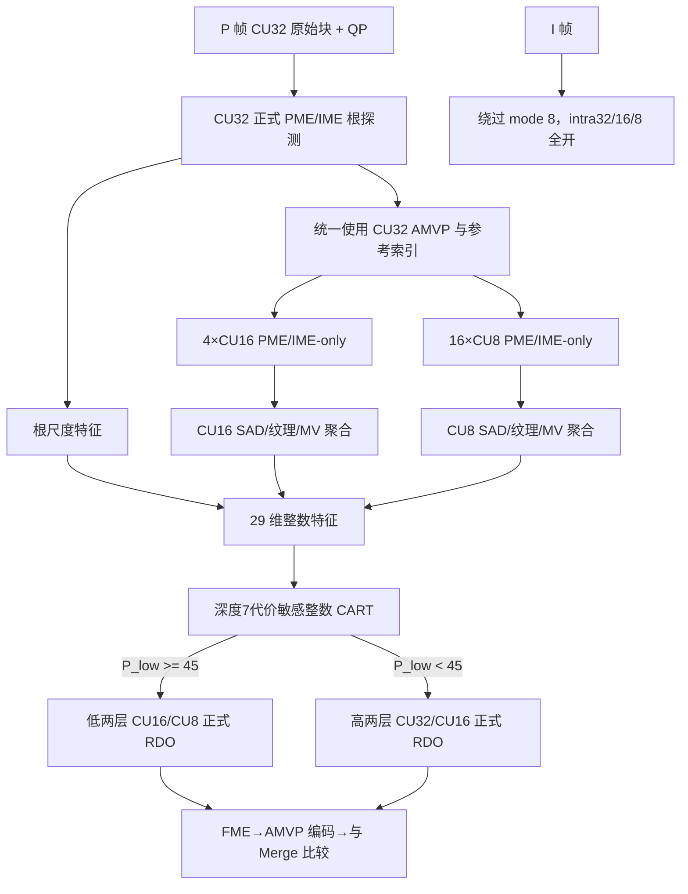

# P 帧多尺度 IME 两层自适应优化报告

## 1. 结论

针对旧版 CU32 单点 IME 判决，本次加入 1 个 CU32、4 个 CU16、16 个 CU8 的多尺度 PME/IME-only 探测，提取 SAD、纹理、分层收益和 MV 一致性，并使用代价敏感整数 CART 决定正式 RDO 搜索高两层（CU32/CU16）或低两层（CU16/CU8）。

在 HEVC Class A/B/C/E 共 17 个序列、每点 30 帧（1I+29P）、QP 22/27/32/37 的相同条件下：

- 旧版自适应两层相对完整三层：平均 **+1.498% BD-rate**，最差 **+2.356%**。
- 新版 mode 8、cutoff 45：平均 **+0.966% BD-rate**，最差 **+1.606%**。
- 平均损失降低 **0.532 个百分点**，相对改善 **35.53%**。
- Class B 平均 **+1.050%**；独立 A/C/E 分类正确率 **84.834%**。
- mode 0 与 mode 8 的单 I 帧在 `--no-info` 下码流均为 47,355 字节，SHA-256 相同；I 帧的 intra32/intra16/intra8 均保持开放。

因此，本轮已把全测试集平均损失降到 1% 以下，但不能宣称每个序列都低于 1%；Kimono1、Johnny、Traffic、BasketballDrill 和 BasketballDrive 仍高于 1%。

## 2. 测试条件

| 项目 | 设置 |
|---|---|
| 编码结构 | 1 个 I 帧 + 29 个 P 帧，无 B 帧 |
| 序列 | Class A/B/C/E，17 个序列 |
| QP | 22、27、32、37 |
| x265 | `medium`、`zerolatency`、定 QP |
| 参考帧 | 1 |
| CTU/CU | CTU32，最小 CU8，正方形 PU |
| 关闭项 | Rect、AMP、weightp、weightb、scenecut、early-skip、rskip |
| anchor | 硬件 PME→IME→FME，完整 CU32/CU16/CU8 三层 |
| 被测 | 相同运动搜索，P 帧 mode 8 自适应高两层/低两层 |
| I 帧 | 强制完整 intra32/intra16/intra8，不接受 P 帧选层控制 |
| BD-rate | 四点 Y-PSNR，公共质量区间内对 `ln(rate)` 三次拟合 |

短序列速度容易受主机负载影响。mode 8 在软件 x265 中还额外串行执行 20 个 PME/IME-only 探测，17 序列平均软件速度比为 0.722×；它的目标是硬件并行、流水和结果复用，不能把当前软件时间当作最终 RTL 吞吐收益。

## 3. 为什么 CU32 单点 IME 不够

旧版仅使用 CU32 的 IME SAD、PME→IME 修正量、MV 幅度、MVD、纹理和窗口边界。它无法回答两个关键问题：

1. CU32 的残差是否集中在局部区域，拆成 CU16/CU8 后是否显著下降；
2. 一个 CU32 内是否存在多个不一致的运动方向，必须由 CU8 表达。

新方案直接观察不同尺度，特别使用 CU8 SAD 离散度、CU16→CU8 SAD 收益以及子块 MV 相对父块/根块的一致性。这些量比单一 CU32 SAD 更接近“拆分是否值得”。

## 4. 数据通路与流程



边缘处不足完整 32×32/16×16/8×8 几何的 CTU 不生成多尺度特征，安全回退到旧版 CU32 判决。

## 5. 29 个整数输入特征

所有 SAD 特征统一成 Q8 每像素，避免块面积导致量级不同：

- CU32：`sad32_q8 = (SAD32 + 2) >> 2`；
- CU16：256 像素，原始 `SAD16` 数值即 Q8 每像素；
- CU8：`sad8_q8 = SAD8 << 2`。

| 组 | 特征 |
|---|---|
| QP/根块 | QP、CU32 SAD、PME→IME L1、CU32 MVD L1、CU32 MV L1、CU32 activity、CU32 boundary |
| CU16 SAD | 均值、极差、平均绝对偏差 MAD |
| CU8 SAD | 均值、极差、MAD |
| 分层 SAD 收益 | 32→16 平均收益、16→8 平均收益、16→8 最大父块收益 |
| CU16 MV | 相对根 MV 的平均/最大 L1、四个 CU16 的二维 span |
| CU8 MV | 相对父 CU16 的平均/最大 L1、相对根的平均/最大 L1、16 个 CU8 的二维 span |
| 纹理 | CU16 activity 均值/极差、CU8 activity 均值/极差 |
| 搜索稳定性 | 根、4 个 CU16、16 个 CU8 的 IME 边界命中计数 |

聚合仅使用加法、绝对值、min/max 和 `/4`、`/16` 的舍入移位。决策树推理仅使用无符号整数比较、分支和常数概率返回。

## 6. QPstep 与 sqrt(lambda)

方案明确考虑二者，但避免重复输入：

1. 运动搜索中，x265 的 `x265_lambda_tab[QP]` 是运动估计码率项使用的 sqrt(lambda)。IME/FME 代价为 `SAD + sqrt(lambda) × MVD_bits`；自适应 PME 也使用该 Q8 表并叠加纹理权重。
2. 层选择树把 QP 作为第 0 个显式特征。`QPstep ∝ 2^(QP/6)`，sqrt(lambda) 也由 QP 单调确定；在固定 slice 类型、bit depth 和 lambda 表时，单独再输入原始 QPstep 或 sqrt(lambda) 不会增加信息，只是 QP 的单调重编码。
3. CART 可以先按 QP 分段，再对 SAD/SAD gain/MV 特征设置不同阈值，等价于学习 QPstep/lambda 相关的分块边界。最终树中 QP 有 16 个分裂，累计加权 Gini 收益最高，证明 QP 影响已被实际使用。
4. 曾考虑把 SAD 或 SAD gain 除以 QPstep/sqrt(lambda)；这需要倒数 LUT、乘法器或可变精度除法，而且与现有 QP 分支高度共线。本轮没有证据证明其能改善真实 BD-rate，因此最终硬件版不加入该冗余数据通路。

若迁移平台修改了 lambda 表、bit depth、slice lambda 修正或 AQ，应重新采数训练，或把平台实际 `sqrt_lambda_q8` 作为扩展特征重新验证，不能假设本模型直接等价。

## 7. 训练过程

### 7.1 标签采集

使用 mode 7 编码完整三层，不做裁剪。每个有效 CU32 输出一行 `INTERLAYERMS`：

```text
INTERLAYERMS,ctu,x,y,valid,f0,...,f28,leaf32,leaf16,leaf8,oracle
```

`oracle=low` 当完整 RDO 的最终叶节点中存在 CU8，否则为 `high`。Class B 5 个序列、12 帧、四个 QP 共记录 448,800 行，其中 435,600 个完整 CTU 有效，13,200 个边缘 CTU 无效，字段错误为 0。

### 7.2 模型

- CART 最大深度：7；
- 最小叶节点：256；
- LOW 类权重：1.5；
- 推理阈值：45；
- 训练目标：降低“oracle LOW 却预测 HIGH”的代价，即减少误删 CU8；
- 验证：Class B 按序列留一交叉验证，A/C/E 冻结模型独立验证。

Class B 留一验证在 cutoff 45 下：准确率 77.731%、平衡准确率 79.305%、LOW recall 84.880%、误删 CU8 率 15.120%。A/C/E 独立验证共有 652,960 个有效 CTU：准确率 84.834%、平衡准确率 84.934%、LOW recall 85.394%、误删 CU8 率 14.606%。

### 7.3 特征重要性

前八个累计加权 Gini 收益特征依次为：QP、CU8 activity 极差、CU8 SAD 极差、CU32 SAD、CU16→CU8 平均 SAD 收益、CU32 MV L1、CU16→CU8 最大 SAD 收益、CU8 SAD 均值。MV span/一致性进入了树，但属于辅助特征；真正主导的是 QP、CU8 纹理/SAD 离散度和分层 SAD 收益。

## 8. 阈值选择

Class B 的 30 帧真实编码结果：

| cutoff | 低两层选择比例 | Class B 平均 BD-rate | 最差序列 |
|---:|---:|---:|---:|
| 45 | 47.17% | **+1.050%** | +1.606% |
| 50 | 43.43% 左右 | +1.121% | +1.537% |
| 55 | 约 39.7% | +1.221% | +1.716% |
| 60 | 约 36.3% | +1.266% | +1.863% |

cutoff 45 由真实 BD-rate 选定。没有按序列或按 QP 单独选择阈值；曾检查从不同阈值运行中拼接 QP 点的方法，但三次曲线拟合会产生虚假负 BD-rate，因此明确拒绝该过拟合做法。

## 9. A/B/C/E 逐序列结果

| Class | 序列 | 新版 BD-rate | 高两层 | 低两层 |
|---|---|---:|---:|---:|
| A | PeopleOnStreet | +0.670% | 32.93% | 67.07% |
| A | Traffic | +1.350% | 58.94% | 41.06% |
| B | BasketballDrive | +1.259% | 64.35% | 35.65% |
| B | BQTerrace | +0.517% | 40.32% | 59.68% |
| B | Cactus | +0.909% | 52.43% | 47.57% |
| B | Kimono1 | +1.606% | 62.61% | 37.39% |
| B | ParkScene | +0.957% | 52.63% | 47.37% |
| C | BasketballDrill | +1.294% | 54.12% | 45.88% |
| C | BQMall | +0.639% | 48.84% | 51.16% |
| C | PartyScene | +0.368% | 20.40% | 79.60% |
| C | RaceHorses | +0.767% | 30.76% | 69.24% |
| E | FourPeople | +0.958% | 74.58% | 25.42% |
| E | Johnny | +1.405% | 78.42% | 21.58% |
| E | KristenAndSara | +1.050% | 77.21% | 22.79% |
| E | vidyo1 | +1.242% | 77.17% | 22.83% |
| E | vidyo3 | +0.849% | 68.30% | 31.70% |
| E | vidyo4 | +0.578% | 74.74% | 25.26% |

| 汇总 | 新版 | 旧版 | 改善 |
|---|---:|---:|---:|
| Class A | +1.010% | +1.860% | −0.850 pp |
| Class B | +1.050% | +1.424% | −0.374 pp |
| Class C | +0.767% | +1.028% | −0.261 pp |
| Class E | +1.014% | +1.752% | −0.739 pp |
| 17 序列平均 | **+0.966%** | +1.498% | **−0.532 pp** |

## 10. I 帧隔离

`analysis.cpp` 在 I_SLICE 下无条件设置完整 intra 层模式，忽略 `X265_INTRA_*` 环境变量和 P 帧 `--hw-hme-inter-layers`。用 BasketballDrive 第一帧、QP32、`--no-info` 验证：

| 项目 | mode 0 | mode 8 |
|---|---:|---:|
| 码流字节 | 47,355 | 47,355 |
| SHA-256 | `34FA...57BC` | `34FA...57BC` |

## 11. 使用方法

应用覆盖并构建后，推荐运行参数为：

```text
--hw-hme --hw-hme-inter-layers 8 --hw-hme-layer-cutoff 45
--hw-hme-pme-range 32,28 --hw-hme-ime-range 12,12
--hw-hme-pme-cost-mode 1 --hw-hme-pme-rate-scale 256
--hw-hme-pme-texture 8,24 --hw-hme-pme-attractor 1
```

模式定义：0 完整三层；1 强制高两层；2 强制低两层；3 旧版 CU32 自适应；4 旧版标签采集；5 强制 CU32-only；6 CU32-only 级联；7 多尺度标签采集/完整三层；8 多尺度代价敏感自适应两层。

训练：

```powershell
python .\experiments\inter_hw_hme\train_inter_multiscale_tree.py `
  D:\work\collect\runs.csv --output D:\work\model `
  --max-depth 7 --min-leaf 256 --low-weight 1.5 `
  --recommended-cutoff 45 `
  --cpp-header .\x265_overlay\source\encoder\inter_multiscale_gate_model.h
```

独立验证：

```powershell
python .\experiments\inter_hw_hme\evaluate_inter_multiscale_tree.py `
  D:\work\independent\runs.csv --model D:\work\model\inter_multiscale_tree.json `
  --cutoff 45 --output D:\work\independent_accuracy.csv
```

## 12. 移植接口

`portable_c/hw_hme_build_inter_scale_features()` 接收根 CU32、4 个 CU16、16 个 CU8 的 PME/IME-only 结果，生成固定顺序的 29 维数组；`hw_hme_select_inter_layers_multiscale()` 加载生成的 C 模型并输出高两层或低两层。调用方应保证：

1. 三个尺度使用同一参考帧索引和 CU32 AMVP；
2. PME 的 1/4 图像 MV 乘 4 后作为 IME 全像素起点；
3. 子块按 raster 顺序传入，每四个 CU8 对应一个 CU16；
4. 训练和部署使用相同 QP/lambda 表、bit depth、搜索窗和 SAD 定义；
5. 不完整边缘 CTU 使用安全回退，不访问越界样本。

## 13. 后续优化建议

- 对 Kimono1/Johnny/Traffic 等失败样本采集“受限高两层成本”和“受限低两层成本”，把二分类标签升级为真实 CTU RD 损失权重；当前 leaf8 标签仍把所有错误视为同一标签内的近似风险。
- 在 RTL 中并行计算 4×CU16 和 16×CU8 PME/IME，复用下采样 SRAM、候选 SAD 和 AMVP bit-cost；软件串行探测的 0.722× 不代表硬件实现。
- 若要进一步降到每序列均小于 1%，应增加训练帧、运动类别与 QP 覆盖，并保留序列级完全独立测试，避免用同一序列调阈值。
- 若平台实际 lambda/QPstep 规则变化，优先重新训练；只有跨平台验证显示 QP 分支不足时，再加入定点归一化 SAD gain。
