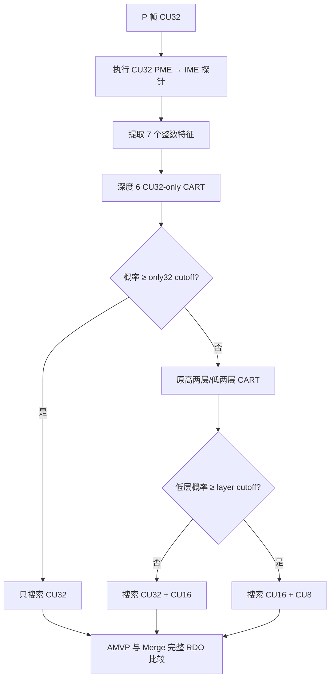

# P 帧“高一层”保守门控：训练、实现与 ABCE 验证

## 1. 结论

本研究在已有“高两层 32/16”和“低两层 16/8”自适应选择之前增加一个 CU32-only（高一层）门控。推荐配置为：

```text
--hw-hme-inter-layers 6
--hw-hme-layer-cutoff 50
--hw-hme-only32-cutoff 92
```

在 Class A/B/C/E 共 17 个序列、每点 30 帧（1I+29P）、QP 22/27/32/37 条件下：

| 指标 | 结果 |
|---|---:|
| 相对完整 32/16/8 三层的平均 BD-rate | +1.500% |
| 相对原高/低两层自适应的增量 BD-rate | **+0.002%** |
| 相对原两层自适应的最差序列增量 | **+0.080%（vidyo1）** |
| 实际 CU32-only 选中率 | 6.425% |
| 相对完整三层的软件编码速度比 | 1.397× |
| Class B 留一序列触发精度 | 92.841% |
| Class A/C/E 独立触发精度 | 93.390% |

因此，“新增高一层”本身的平均压缩损失远低于 0.5%，并且 17 个序列逐一低于 0.5%。总的 +1.500% 仍主要来自原高两层/低两层选择，而不是 CU32-only 门控。

## 2. 决策流程



模式编号：`0` 完整三层；`1` 强制高两层；`2` 强制低两层；`3` 原两层自适应；`4` 完整 RDO 标签采集；`5` 强制 CU32-only；`6` CU32-only 保守门控并回退到原两层自适应。

## 3. 输入特征与硬件计算

所有特征都来自 CU32 的既有 PME/IME 数据和帧级 QP，不读取最终 bits、邻块最终模式或完整 RDO 结果。

| 特征 | 定义 | 硬件运算 |
|---|---|---|
| `qp` | 当前帧定 QP | 寄存器读取 |
| `ime_sad_q8` | `(IME_SAD + 2) >> 2`；CU32 共 1024 像素，即 SAD/像素的 Q8 表示 | 加法、移位 |
| `refine_l1` | `abs(ime_mv - pme_seed_fullpel)` 的 x/y L1 和 | 绝对值、加法 |
| `mvd_qpel_l1` | `abs(ime_mv*4 - AMVP_qpel)` 的 x/y L1 和 | 移位、绝对值、加法 |
| `mv_fullpel_l1` | `abs(ime_mv.x)+abs(ime_mv.y)` | 绝对值、加法 |
| `pme_activity` | 下采样 CU32→8×8 后的均值梯度活动度 | 绝对差、累加、常数除法 |
| `ime_boundary` | IME 最优点是否落在搜索窗边界 | 比较 |

决策树最大深度为 6，推理只包含整数比较和常数返回。当前最终树的最高叶概率为 94；阈值 92 与 94 在该版本模型上选择相同叶节点。保留 92 是为了让重新训练后出现 92/93 概率叶时仍遵守已验证的风险档位。

## 4. 完整训练数据采集

### 4.1 编码条件

- 训练序列：Class B 的 BasketballDrive、BQTerrace、Cactus、Kimono1、ParkScene。
- 每点 12 帧，QP 22/27/32/37；共 448,800 个 CU32 样本。
- `medium`、`zerolatency`、单参考、B 帧关闭、CTU32、最小 CU8、Rect/AMP 关闭。
- `--hw-hme-inter-layers 4` 保持完整 32/16/8 RDO，只采集标签，不裁剪搜索层。

示例：

```powershell
python experiments/inter_hw_hme/run_classb.py `
  --encoder D:/path/to/x265.exe `
  --manifest experiments/inter_hw_hme/sequence_manifest_abce.csv `
  --output D:/work/classb_only32_collect_12f `
  --modes hw --sequences BasketballDrive,BQTerrace,Cactus,Kimono1,ParkScene `
  --frames 12 --qps 22,27,32,37 --layer-mode 4 --force
```

### 4.2 单样本日志格式

```text
INTERLAYERSTAT,<ctu_addr>,<pel_x>,<pel_y>,<qp>,<ime_sad_q8>,<refine_l1>,
<mvd_qpel_l1>,<mv_fullpel_l1>,<pme_activity>,<ime_boundary>,
<leaf32>,<leaf16>,<leaf8>,<two_layer_oracle>
```

- `leaf32/leaf16/leaf8` 是完整 RDO 后各叶 CU 数量。
- CU32-only 正样本定义为 `leaf32 > 0`。在 CTU32 对齐条件下，它表示根 CU32 未递归。
- `two_layer_oracle` 仍供原高/低两层树使用；CU32-only 训练不使用该字符串。
- `runs.csv` 保存序列、QP、帧数、码率、PSNR、速度和日志文件对应关系；训练脚本据此定位 `<sequence>_qp<qp>_hw.log`。

## 5. 训练与导出

```powershell
python experiments/inter_hw_hme/train_inter_only32_gate.py `
  D:/work/classb_only32_collect_12f/runs.csv `
  --output results/inter/only32_classb_train `
  --max-depth 6 --min-leaf 512 --positive-weight 1.0 `
  --recommended-cutoff 92 `
  --cpp-header x265_overlay/source/encoder/inter_only32_gate_model.h `
  --portable-header experiments/inter_hw_hme/portable_c/inter_only32_gate_model.h
```

训练器为纯 Python、无第三方机器学习依赖的整数阈值 CART：

1. 解析所有 `INTERLAYERSTAT` 行，构造 7 维整数特征和 `leaf32>0` 标签。
2. 每个节点枚举各特征的可分整数阈值，以加权 Gini 最小为准选择分裂。
3. 深度达到 6、节点不足 `2×512` 或标签纯净时停止。
4. 对 5 个 Class B 序列做 leave-one-sequence-out 交叉验证，扫描门限。
5. 用全部 Class B 样本重训最终树，并同时导出 JSON、可读文本、x265 C++ 头和 ISO C99 头。

输出文件：

| 文件 | 用途 |
|---|---|
| `inter_only32_tree.json` | 特征顺序、训练参数、完整树和验证摘要 |
| `inter_only32_tree.txt` | 人工审查用 if/else 树 |
| `inter_only32_thresholds_cv.csv` | 各概率阈值的 precision/recall/误触发率 |
| `inter_only32_sequence_cv.csv` | 各训练序列的留一交叉验证结果 |
| `inter_only32_gate_model.h` | x265 C++ 模型 |
| `inter_only32_gate_model_c.h` | 独立 C99 模型 |

## 6. 交叉验证与独立验证

### 6.1 Class B 留一序列交叉验证，cutoff 92

| 样本数 | RDO CU32-only 标签率 | 预测选中率 | 触发精度 | 召回率 | 误触发率 |
|---:|---:|---:|---:|---:|---:|
| 448,800 | 50.710% | 5.338% | **92.841%** | 9.772% | 0.382% |

### 6.2 Class A/C/E 独立验证，cutoff 92

模型不使用 A/C/E 重训。采集 12 帧、QP 22/27/32/37，共 663,520 个样本。

| Class | 样本数 | RDO 标签率 | 预测选中率 | 触发精度 | 误触发率 |
|---|---:|---:|---:|---:|---:|
| A | 352,000 | 38.232% | 4.854% | 94.850% | 0.250% |
| C | 68,640 | 36.611% | 2.248% | 84.511% | 0.348% |
| E | 242,880 | 71.586% | 15.229% | 93.087% | 1.053% |
| A/C/E 合计 | 663,520 | 50.274% | 8.382% | **93.390%** | 0.554% |

这里的“判断正确概率”采用触发精度 `TP/(TP+FP)`。总体分类 accuracy 不适合作为主要指标：保守门控会故意产生大量 false-negative（可选而不选），它降低覆盖率但不会引入额外错误裁剪。

独立验证命令：

```powershell
python experiments/inter_hw_hme/evaluate_inter_only32_gate.py `
  results/inter/only32_classb_train/inter_only32_tree.json `
  D:/work/ace_only32_collect_12f/runs.csv `
  --output results/inter/only32_ace_independent `
  --recommended-cutoff 92
```

## 7. ABCE 30 帧编码结果

### 7.1 推荐 cutoff 92

| Class | 序列 | 对完整三层 BD-rate | 对原两层自适应增量 |
|---|---|---:|---:|
| A | PeopleOnStreet | +1.399% | -0.029% |
| A | Traffic | +2.298% | +0.004% |
| B | BasketballDrive | +1.423% | +0.005% |
| B | BQTerrace | +0.965% | +0.010% |
| B | Cactus | +1.182% | -0.012% |
| B | Kimono1 | +1.706% | -0.063% |
| B | ParkScene | +1.780% | -0.009% |
| C | BasketballDrill | +1.440% | +0.011% |
| C | BQMall | +1.313% | +0.002% |
| C | PartyScene | +0.432% | +0.019% |
| C | RaceHorses | +0.959% | +0.001% |
| E | FourPeople | +1.439% | -0.031% |
| E | Johnny | +2.012% | -0.026% |
| E | KristenAndSara | +2.388% | +0.035% |
| E | vidyo1 | +1.657% | **+0.080%** |
| E | vidyo3 | +1.852% | +0.003% |
| E | vidyo4 | +1.247% | +0.029% |
| **全部** | **算术平均** | **+1.500%** | **+0.002%** |

实际选择率：

| Class | CU32-only | 高两层 32/16 | 低两层 16/8 |
|---|---:|---:|---:|
| A | 4.47% | 43.70% | 51.83% |
| B | 4.69% | 45.12% | 50.19% |
| C | 1.67% | 33.71% | 64.62% |
| E | 13.80% | 53.46% | 32.74% |
| 全部 | **6.425%** | 45.786% | 47.789% |

### 7.2 阈值和边界对照

| 策略 | 对完整三层平均 BD-rate | 对原两层增量 | CU32-only 率 | 速度比（对完整三层） |
|---|---:|---:|---:|---:|
| 强制 CU32-only | +35.860% | — | 100% | 3.280× |
| 级联，cutoff 89 | +1.542% | +0.042% | 15.707% | 1.385× |
| 级联，cutoff 92 | **+1.500%** | **+0.002%** | **6.425%** | **1.397×** |

强制 CU32-only 最差为 BQMall 的 +77.450%，证明高一层必须是高精度门控。cutoff 89 平均也满足 0.5%，但 vidyo1 相对原两层为 +0.784%，因此不推荐作为逐序列风险受控的默认配置。

## 8. 运行正式编码

单次 x265 的关键参数：

```text
--preset medium --tune zerolatency --qp <QP>
--ctu 32 --min-cu-size 8 --no-rect --no-amp
--bframes 0 --ref 1 --frame-threads 1 --no-scenecut
--hw-hme --hw-hme-pme-range 32,28 --hw-hme-ime-range 12,12
--hw-hme-pme-cost-mode 1 --hw-hme-pme-rate-scale 256
--hw-hme-pme-texture 8,24 --hw-hme-pme-attractor 1
--hw-hme-inter-layers 6 --hw-hme-layer-cutoff 50
--hw-hme-only32-cutoff 92 --hw-hme-stats
```

批量测试：

```powershell
python experiments/inter_hw_hme/run_inter_layer_sweep.py `
  --encoder D:/path/to/x265.exe `
  --manifest experiments/inter_hw_hme/sequence_manifest_abce.csv `
  --anchor-runs D:/work/full3/runs.csv --anchor-mode hw `
  --output D:/work/only32_abce_30f `
  --frames 30 --qps 22,27,32,37 `
  --variants 5:50:92,6:50:89,6:50:92 --force
```

## 9. 移植指导

1. 先移植 `portable_c/hw_hme_reference.*` 和生成的 `inter_only32_gate_model.h`，运行 `test_hw_hme`。
2. 保证 PME 下采样坐标、IME full-pel、AMVP qpel 三种精度严格对齐。
3. 只在 32×32 根 CU、正方形 CU=PU=TU 配置调用高一层门控。
4. 高一层未触发时必须继续执行高两层/低两层树，不能直接回完整三层，否则测试定义改变。
5. 高一层触发后仍需完成 CU32 的 AMVP/Merge/RDO；门控只禁止递归到 16/8。
6. 在新平台重新采集 mode-4 标签并训练，不要直接假定 Class B 树对所有摄像头、bit depth 和搜索器都最优。
7. 发布前至少检查触发精度、误触发率、逐序列增量 BD-rate 和最差序列，不要只看总体 accuracy 或平均 BDRate。

原始精简 CSV 位于 `results/inter/only32_abce_30f/`，训练模型位于 `results/inter/only32_classb_train/`，独立验证位于 `results/inter/only32_ace_independent/`。
